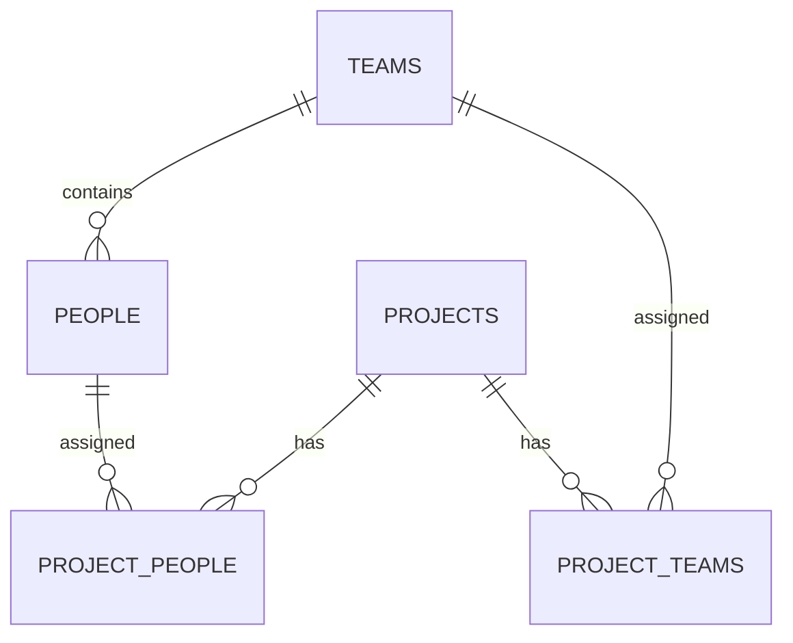

# Project Registry — backend

Serverová část aplikace pro evidenci projektů, osob a týmů. Poskytuje REST API
pro webové rozhraní a zajišťuje přístup k relační databázi SQLite.
Backend je samostatná aplikace s vlastním sestavením a provozní konfigurací.

Aplikace poskytuje CRUD projektů, osob a týmů, přímé přiřazování osob a týmů
k projektům a výpočet všech účastníků. Detail osoby zahrnuje i projekty získané
přes její tým. Vstupy se validují na serveru a vztahy chrání omezení SQLite.

## Návrh aplikace

HTTP komunikaci obsluhuje Fastify. Vytvoření aplikace je oddělené od otevření
síťového portu, takže endpointy lze testovat bez spouštění samostatného serveru.
Databázové spojení se aplikaci předává při jejím sestavení.

SQLite uchovává data v souboru a nevyžaduje samostatný databázový server.
Knihovna `better-sqlite3` poskytuje rozhraní pro SQL dotazy. Při otevření databáze
se vždy zapíná a ověřuje vynucování cizích klíčů, které bude chránit vztahy mezi
záznamy. Databázový soubor a potřebný adresář vznikají automaticky.

## Hlavní části

- **Konfigurace** (`src/config.ts`) načítá hostitele, port a cestu k databázi
  z prostředí a kontroluje platnost portu.
- **Databáze** (`src/db.ts`) otevírá SQLite a ověřuje nastavení cizích klíčů.
- **HTTP aplikace** (`src/app.ts`) sestavuje Fastify a registruje endpointy.
- **Spuštění a ukončení** (`src/server.ts`) propojuje konfiguraci, databázi
  a server. Při ukončení uzavírá server i databázové spojení.
- **Datový model a seed** (`src/schema.ts`, `src/seed.ts`) připravují tabulky a syntetická data.
- **REST endpointy** (`src/routes/`) řeší CRUD, validaci a přiřazení.
- **Účastníci** (`src/participants.ts`) odvozují účast z přímých a týmových vazeb.
- **Testy** (`src/*.test.ts`) ověřují CRUD, validaci, integritu a týmovou účast
  v izolované databázi v paměti.
- **Kontejnerový provoz** (`Dockerfile`, `compose.yaml`) zajišťuje Linux sestavení
  backendu a propojení s frontendem.

## Technologie

Backend používá Node.js 24.22.0, TypeScript a Fastify 5. SQLite je dostupná přes
`better-sqlite3`. Vývojové spouštění zajišťuje `tsx`, testy využívají test runner
Node.js a HTTP simulaci Fastify `inject`. Volta vybírá verzi Node.js podle
`package.json`; konkrétní závislosti zaznamenává `package-lock.json`.

## API

### GET /api/health

Kontrola dostupnosti služby ověří databázi provedením `SELECT 1`.
Při úspěchu vrací HTTP **200**:

```json
{"status":"ok","database":"ok"}
```

Pokud se databázový dotaz nepodaří, vrací HTTP **503**:

```json
{"status":"error","database":"error"}
```

Endpoint slouží také pro Docker healthcheck. Ověřuje dostupnost databázového spojení.

### Projekty

- `GET /api/projects`: seznam v objektu `items`.
- `POST /api/projects`: vytvoření, HTTP 201 a `Location`.
- `GET /api/projects/:id`: údaje, `directPeople`, přiřazené `teams` a `participants`.
- `PATCH /api/projects/:id`: úprava vybraných polí, HTTP 200.
- `DELETE /api/projects/:id`: smazání projektu a jeho vazeb, HTTP 204.

Příklad těla vytvoření:

```json
{"name":"Projekt Vega","description":"Syntetický projekt","status":"planned","startDate":"2026-11-01","endDate":null}
```

PATCH přijímá část stejných polí, například `{"status":"in_progress"}`.
Stavy jsou `planned`, `in_progress`, `completed`. Datum musí existovat v kalendáři;
konec nesmí předcházet začátku. Při PATCH se kontroluje výsledný záznam včetně
již uložených hodnot. Datum ukončení je volitelné i při stavu `completed`.

### Osoby

- `GET /api/people`: seznam v `items`.
- `POST /api/people`: vytvoření, HTTP 201 a `Location`.
- `GET /api/people/:id`: osoba, její `team` a efektivní `projects`.
- `PATCH /api/people/:id`: úprava, včetně převodu do jiného týmu, HTTP 200.
- `DELETE /api/people/:id`: smazání osoby a přímých vazeb, HTTP 204.

Příklad těla vytvoření:

```json
{"name":"Osoba 004","email":"osoba004@example.com","jobTitle":"Vývojář","teamId":1}
```

PATCH přijímá část těchto polí, například `{"teamId":2}`. Každá osoba musí mít
existující tým. E-mail musí mít platný formát, ukládá se malými písmeny a je unikátní.

### Týmy

- `GET /api/teams`: seznam v `items`.
- `POST /api/teams`: vytvoření, HTTP 201 a `Location`.
- `GET /api/teams/:id`: tým, `members` a přiřazené `projects`.
- `PATCH /api/teams/:id`: úprava, HTTP 200.
- `DELETE /api/teams/:id`: smazání prázdného týmu a jeho projektových vazeb, HTTP 204.

Příklad těla vytvoření:

```json
{"name":"Tým Gama","description":"Syntetický tým"}
```

PATCH přijímá část těchto polí, například `{"description":"Upravený popis"}`.
Název týmu je unikátní bez rozlišení velikosti písmen. Obsazený tým nelze smazat.

### Přiřazení osob a týmů

- `PUT /api/projects/:projectId/people/:personId`: přímé přiřazení osoby.
- `DELETE /api/projects/:projectId/people/:personId`: odebrání přímé vazby.
- `PUT /api/projects/:projectId/teams/:teamId`: přiřazení týmu.
- `DELETE /api/projects/:projectId/teams/:teamId`: odebrání týmové vazby.

Tyto operace nemají tělo a vracejí HTTP 204. Opakovaný PUT nebo DELETE existujícího
projektu a osoby/týmu má stejný výsledný stav; chybějící vazba není chyba,
neexistující entita vrací 404. Příklad pro syntetický projekt a tým s ID 1:

```bash
curl -X PUT http://localhost:3000/api/projects/1/teams/1
curl http://localhost:3000/api/projects/1
```

Účastníci jsou sjednocení přímých osob a aktuálních členů přiřazených týmů.
Každá osoba je v `participants` jednou podle ID. Příznaky `direct` a `viaTeam`
rozlišují zdroje účasti. Obdobné příznaky má seznam projektů v detailu osoby.
Odebrání přímé vazby zachová účast přes tým. Změna týmu okamžitě změní nepřímé
účasti; přímá přiřazení zachová. Historie členství se neuchovává.

### Chybové odpovědi

HTTP 400 znamená neplatný vstup (včetně prázdného PATCH a neznámých polí),
404 neexistující entitu či endpoint, 409 duplicitní hodnotu nebo obsazený tým.
Neočekávaná chyba vrací 500 bez interních SQL informací. Odpovědi 204 nemají tělo.

```json
{"error":{"code":"VALIDATION_ERROR","message":"Datum ukončení nesmí předcházet zahájení."}}
```

## Datový model

Pět tabulek: `projects`, `people`, `teams`, `project_people`, `project_teams`.
ID jsou celá čísla. Data projektu obsahují název, popis, stav a datumy;
osoba jméno, e-mail, pozici a tým; tým název a volitelný popis.
Datumy jsou texty `YYYY-MM-DD`, bez převodů časového pásma.
Spojovací tabulky mají složené primární klíče a neumožní duplicitní přiřazení.



`people.team_id` je povinný FK s `ON DELETE RESTRICT`. FK ve spojovacích tabulkách
mají `ON DELETE CASCADE`; smazání projektu nikdy nesmaže osoby ani týmy.
Unikátnost e-mailu a názvu týmu chrání i DB. SQL hodnoty jsou parametrizované.

Při startu se schéma vytvoří, pokud ještě neexistuje. `CREATE TABLE IF NOT EXISTS`
není migrace existující struktury: případné budoucí změny schématu vyžadují
samostatnou migraci. Seed se standardně zapíná a plní pouze původně prázdnou DB;
`DEMO_SEED=false` jej vypne. V této verzi je `PRAGMA user_version=1` rezervované
jako trvalá značka provedení/přeskočení seedu, nikoli čítač migrací. Značka a data
vznikají v jedné transakci, restart nevrací smazané záznamy ani nepřepisuje změny.

Ukázková data obsahují pouze smyšlené osoby `Osoba 001` až `003` s adresami
na `example.com`, týmy Alfa/Beta a Projekt Orion. Orion má přiřazený tým Alfa
a přímo osoby 002/003; výsledkem jsou tři účastníci, osoba 002 má oba zdroje.
Aplikace nemá přihlášení a je určena pro lokální demo se syntetickými údaji.

## Konfigurace a uložení dat

`HOST` určuje síťové rozhraní, `PORT` port služby a `DATABASE_PATH` cestu k SQLite
souboru. Výchozí hodnoty jsou uvedené v `.env.example`. Při lokálním vývoji
příkazy `dev` a `start` načítají případný `.env`; již nastavené proměnné prostředí
mají přednost. Databáze standardně vzniká v ignorované složce `data/`.

Docker Compose provozuje dvě služby: backend a Nginx s frontendem. Navenek je
na portu 8080 dostupný pouze frontend, který předává API požadavky backendu.
SQLite soubor `/app/data/app.sqlite` se ukládá do pojmenovaného volume
`project-registry-data`, takže přežije nahrazení kontejneru.
Název celého Compose projektu je výslovně nastavený na `project-registry`,
nezávisle na názvu složky backendu. Lokální databáze a databáze
v Dockeru jsou oddělené. Zastavení přes `docker compose down` volume zachová;
přidání přepínače `-v` jej včetně dat odstraní.

## Spuštění

Lokální vývoj vyžaduje Node.js 24.22.0. Příprava konfigurace a závislostí:

```bash
cp .env.example .env
npm ci
npm run dev
```

API je dostupné na [http://localhost:3000](http://localhost:3000).
`npm test` spustí testy. Pro sestavenou aplikaci slouží `npm run build`
a následně `npm start`.

Celý projekt lze spustit pomocí Dockeru s Compose. Oba repozitáře musí být
naklonované vedle sebe jako `project-registry-backend` a `project-registry-frontend`.
V backendové složce se celek sestaví a spustí příkazem:

```bash
docker compose up --build -d --wait
```

Rozhraní aplikace je potom dostupné na
[http://localhost:8080](http://localhost:8080), kontrola služby na
[http://localhost:8080/api/health](http://localhost:8080/api/health).
